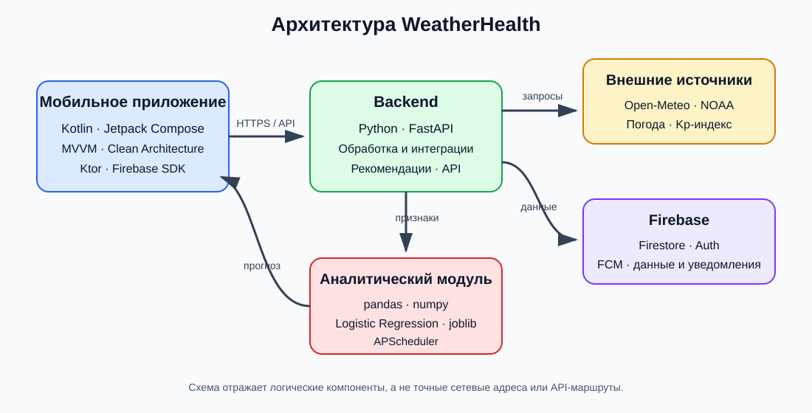

# Архитектура WeatherHealth

## Общая схема

WeatherHealth состоит из мобильного клиента, backend-сервиса, облачного хранилища и внешних источников данных.

## Мобильное приложение

Клиентская часть разрабатывается на Kotlin с использованием Jetpack Compose. В проекте указаны архитектурные подходы MVVM и Clean Architecture с разделением на слои:

- **Presentation** — экраны, состояния и пользовательские действия;
- **Domain** — сценарии использования и бизнес-правила;
- **Data** — получение и сохранение данных, сетевые и Firebase-источники.

Для сетевого взаимодействия указаны Ktor Client, Kotlinx Serialization, Coroutines и Flow. Для внедрения зависимостей применяется Koin. В отчёте также упомянут Reduce-event driver pattern.

## Серверная часть

Backend реализуется на Python и FastAPI. Uvicorn используется как ASGI-сервер. Сервер выполняет следующие задачи:

1. принимает запросы мобильного клиента;
2. работает с пользовательскими данными и Firestore;
3. получает внешние погодные и геомагнитные данные;
4. подготавливает признаки для аналитики;
5. формирует прогнозы и рекомендации;
6. организует фоновые задачи и отправку уведомлений.

В проекте перечислены Open-Meteo API для погодных данных и NOAA Space Weather для геомагнитной информации. Также упоминаются `openmeteo-requests` и `openmeteo-sdk`.

## Аналитика и персональная модель

Для обработки данных используются pandas и numpy. В качестве алгоритма машинного обучения указана Logistic Regression из scikit-learn. Сериализация модели выполняется с помощью joblib.

После накопления 10 записей дневника backend формирует обучающую выборку, объединяющую сведения о самочувствии, погодные признаки и геомагнитную активность. Персональная модель может обновляться по мере поступления новых записей. Для фоновых задач применяется APScheduler.

## Облачное хранилище

В качестве облачной NoSQL-базы данных используется Firebase Firestore. Основная коллекция — `users`. Внутри пользовательского документа предусмотрены подколлекции:

| Подколлекция | Назначение |
|---|---|
| `diary_entries` | Записи метео-дневника |
| `ml_model` | Состояние и сведения о персональной модели |
| `predictions` | Прогнозы, причины, симптомы и рекомендации |
| `settings` | Настройки уведомлений и порогов |
| `stats` | Статистические данные |

## Поток обработки

1. Пользователь создаёт запись дневника в приложении.
2. Данные сохраняются в Firestore.
3. Backend получает историю и связывает её с погодными и геомагнитными данными.
4. Аналитический модуль подготавливает признаки и при достаточном объёме истории обучает или обновляет персональную модель.
5. Сервис формирует оценку риска, причины, вероятные симптомы и рекомендации.
6. Результат становится доступен мобильному клиенту; для уведомлений предусмотрен Firebase Cloud Messaging.

Точные маршруты REST API, формат всех DTO и схема авторизации backend в исходном отчёте не перечислены. Поэтому данный раздел описывает архитектурные компоненты и поток данных, но не утверждает конкретные URL endpoint-ов.

Перейдите к [Справочнику](reference.md) для просмотра терминов и полей данных.
