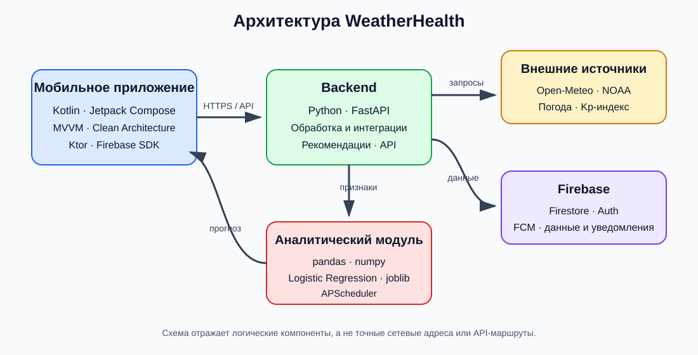
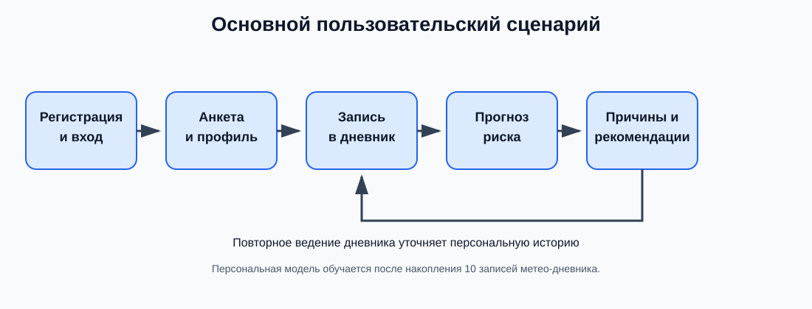

# WeatherHealth

**WeatherHealth** — мобильное приложение для метеочувствительных пользователей. Оно объединяет погодные и геомагнитные данные, дневник самочувствия, персональный профиль, прогнозирование риска и рекомендации.

## Назначение

Документация предназначена для пользователей приложения, а также для специалистов, изучающих его устройство и сопровождение. Она помогает разобраться с началом работы, ведением метео-дневника, интерпретацией прогноза и техническими компонентами системы.

## Основные возможности

- регистрация и авторизация пользователя;
- заполнение стартовой анкеты и настройка профиля;
- получение погодных данных и геомагнитного Kp-индекса;
- ведение дневника самочувствия;
- отображение индекса благополучия и уровня риска;
- объяснение факторов риска и вероятных симптомов;
- персональные профилактические рекомендации;
- статистика, графики и push-уведомления;
- обучение персональной модели по истории дневника.

## Навигация по документации

| Раздел | Для чего нужен |
|---|---|
| [Быстрый старт](quick-start.md) | Первые действия после установки |
| [Установка и настройка](installation.md) | Состав системы и подготовка окружения |
| [Руководство пользователя](user-guide.md) | Профиль, дневник, прогноз и рекомендации |
| [Архитектура](architecture.md) | Мобильный клиент, backend и хранилище |
| [Справочник](reference.md) | Параметры, источники данных и термины |
| [Устранение неисправностей](troubleshooting.md) | Типовые ситуации и способы проверки |

## Общая схема взаимодействия

## Пользовательский сценарий

> **Важно.** WeatherHealth предоставляет информационные оценки и рекомендации, а не медицинский диагноз. При ухудшении состояния следует руководствоваться рекомендациями лечащего врача и обращаться за медицинской помощью при необходимости.

**Разделы документации:** [Быстрый старт](quick-start.md) · [Установка](installation.md) · [Руководство](user-guide.md) · [Справочник](reference.md)
